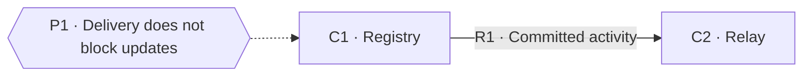

# Task product — System Model

## Scope and evidence

This fixture models the behavior in before.py. It is a static model; there is no deployed service, queue worker, or external provider available for inspection. The proposed implementation is after.py.

## System diagram

## Components

- **C1 · Registry:** Owns task titles; before.py:update_task changes state and records activity.
- **C2 · Relay:** Processes activity and delivers notifications; only the injected notify boundary is available here, so processing and provider behavior remain uninspected.

## Relationships

- **R1 · Registry → Relay:** Registry records activity for later delivery without awaiting provider completion; statically traced in before.py:update_task, with downstream processing unavailable.

## Principles

- **P1 · Notification availability must not determine whether a task update succeeds.** Documented: the fixture's product owner chose independent task updates because notification outages must not prevent editing. Governs C1, C2, and R1; before.py records activity and returns without invoking notify.
- **P2 · Each activity should produce exactly one notification.** Inferred: events appear to identify individual updates, but neither retry behavior nor architectural intent has been confirmed. Governs C2 and R1; no worker is available to establish delivery guarantees.

## Unknowns

Queue durability, retry policy, provider delivery, and P2's intended guarantee remain unverified.
